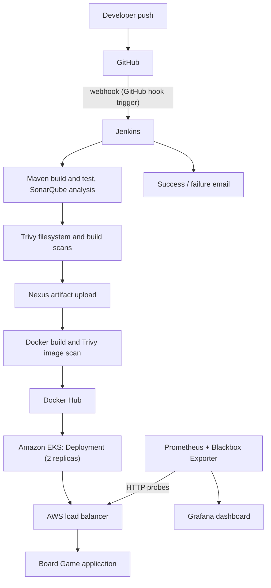

# Architecture Notes

## Flow

## Design decisions

- **One server per tool.** Jenkins, SonarQube, Nexus, Ansible, the Kubernetes management host and the monitoring stack each run on their own EC2 instance, so a problem in one tool does not take down the others.
- **Docker for the tools too.** SonarQube and Nexus run as containers, which keeps their installation to a single command and their data isolated from the host.
- **Managed Kubernetes.** The cluster is Amazon EKS (2 `t3.medium` worker nodes) created with `eksctl`; AWS runs the control plane.
- **Secrets stay in Jenkins.** The SonarQube token, Docker Hub login and AWS keys live in the Jenkins credential store and are referenced by ID.
- **Black-box monitoring.** Blackbox Exporter checks the application from the outside, the way a user reaches it, through the load balancer URL.

## Known limitations

- Only the SonarQube and Nexus servers are defined in Terraform; the other servers and the EKS cluster were created separately.
- The image uses the `latest` tag, and the Deployment has no readiness probe or explicit rolling-update strategy, so zero-downtime rollouts are not guaranteed.
- Security group rules are broad lab settings and should be restricted to known IP ranges.
- SonarQube still reports open findings; the quality gate passes, but the code is not issue-free.
